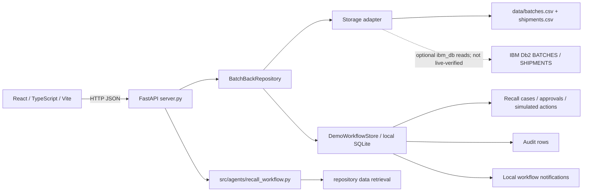

# BatchBack system architecture

## Status and scope

BatchBack is a React + TypeScript + Vite web client and FastAPI backend. Its current verified operating path uses illustrative CSV batch/shipment data and local SQLite for recall workflow state. The optional IBM Db2 adapter is implemented but has not been tested against a live Db2 service. There is no integrated LLM or approved agent framework.

## Component architecture



### UI and API

The React router renders the landing/About and operational pages. Data requests use the FastAPI API base URL (`VITE_API_BASE_URL`, default `http://127.0.0.1:8000`). FastAPI validates recall mutations with Pydantic and serves batch, investigation, dashboard, report, notification, recall-case, and audit endpoints. Recall endpoints are local prototype operations only.

### Data modes: do not conflate these stores

1. **CSV demo records:** `DemoDBAdapter` loads `data/batches.csv` and `data/shipments.csv`. This is the default and is the mode used for the test results.
2. **Optional Db2 reads:** `Db2Adapter` uses `ibm_db` when `DATABASE_MODE=db2` and DSN/user/password environment settings are present. It queries only `BATCHES` and `SHIPMENTS`, checks required result columns, and returns CSV fallback data after logged read errors. No Db2 host/edition/connection/schema/application result was provided or verified.
3. **Local SQLite workflow state:** `DemoWorkflowStore` persists recall cases, destination action progress, approvals, audit rows, and workflow notifications in `DEMO_STATE_DB` (default `data/batchback-demo-workflow.sqlite3`). This store remains SQLite regardless of the batch/shipment adapter mode. It is not a Db2 persistence layer or production audit implementation.

`/health` reports whether a Db2 connection and expected table shape check succeeds if Db2 mode is configured. API data-provenance fields report when records came from demo/fallback data. A Db2 schema DDL file is a proposed baseline, not an applied or validated schema.

## Investigation workflow (actual implementation)

The project does not implement a LangChain/LlamaIndex/Haystack/CrewAI/Langflow agent or LLM flow. The actual workflow is deterministic:

```mermaid
sequenceDiagram
  participant Operator
  participant UI as React UI
  participant API as FastAPI
  participant Logic as investigate_batch
  participant Repo as Repository / adapter
  Operator->>UI: Select batch for investigation
  UI->>API: GET /api/batches/{batch_id}/investigate
  API->>Logic: investigate_batch(repo, batch_id)
  Logic->>Repo: get_batch_by_id(batch_id)
  Logic->>Repo: get_shipments_for_batch(batch_id)
  Repo-->>Logic: Batch and shipment rows
  Logic->>Logic: Score batch risk, shipment count, reported inventory
  Logic->>Logic: Generate priority, evidence, recommendation, trace
  Logic-->>API: Result with data provenance
  API-->>UI: JSON decision support
  UI-->>Operator: Display; human judgment required
```

The heuristic score is:

```text
min(30 baseline
    + batch risk weight (Low 15 / Medium 35 / High 55 / Critical 75)
    + min(20, shipment row count * 5)
    + min(15, total reported inventory // 100),
    100)
```

Priority bands are `<40 Low`, `40–59 Medium`, `60–79 High`, and `>=80 Critical`. This is a prototype heuristic, not validated or suitable for real-world safety decisions. `src/tools/recall_tools.py` contains helper functions but is not an LLM tool-calling runtime and is not the invoked FastAPI investigation path.

## Recall workflow state machine

```text
create case -> Awaiting approval
  -> human decision: Approved -> operator records simulated destination actions -> Closed
  -> human decision: Rejected
```

Only approved cases allow destination simulation. Closure requires at least one action and all actions simulated complete. An open case per batch and one approval per case are enforced by SQLite indexes/constraints. Simulated actions do not contact destinations or alter real inventory. Each mutation stores a local audit record with operator and reason/notes.

## API surface

| Method and path | Implementation behavior |
|---|---|
| `GET /health` | Service and selected database status; rule-based analysis mode. |
| `GET /api/dashboard` | Batch/shipment-derived metrics plus local workflow counts. |
| `GET /api/batches` | Batch rows from configured adapter. |
| `GET /api/batches/{batch_id}` | Batch record or 404. |
| `GET /api/batches/{batch_id}/investigate` | Deterministic investigation described above. |
| `GET /api/notifications` | Sample and local workflow notifications. |
| `GET /api/reports` | Current batch/shipment rows, local recalls/audit, source provenance. |
| `GET /api/recalls` | List locally persisted cases. |
| `POST /api/recalls` | Create case from current investigation snapshot. |
| `GET /api/recalls/{recall_id}` | Retrieve case, actions, and approval details. |
| `POST /api/recalls/{recall_id}/approval?decision=approved\|rejected` | Record a human decision and reason. |
| `POST /api/recalls/{recall_id}/actions/{action_id}/simulate` | Record one simulated destination step. |
| `POST /api/recalls/{recall_id}/close` | Close an approved case after all simulated steps. |
| `GET /api/audit?recall_id=...` | List local workflow audit records. |

## IBM Db2 schema design and actual queries

The proposed DDL is `src/database/db2_schema.sql`. The model includes:

- `SUPPLIERS` → `PRODUCTS` → `BATCHES` → `PRODUCTION_RECORDS`
- `WAREHOUSES`, `DISTRIBUTORS`, `RETAIL_DESTINATIONS`, and `SHIPMENTS` linked by optional shipment foreign keys and required batch linkage
- `INVESTIGATIONS` → `RISK_ASSESSMENTS`
- `BATCHES` → `RECALL_CASES` → `APPROVALS` and `RECALL_ACTIONS`
- `NOTIFICATIONS` and `AUDIT_LOGS`
- Indexes on shipment batch ID, shipment destination, and audit recall ID

This design is not evidence that these tables exist in a Db2 service. The current adapter only reads `BATCHES` and `SHIPMENTS`; it does not execute writes for recalls, approvals, notifications, or audits in Db2.

When enabled, the adapter's batch and shipment queries are equivalent to:

```sql
SELECT * FROM BATCHES ORDER BY PRODUCTION_DATE DESC;
SELECT * FROM SHIPMENTS ORDER BY SHIPPED_DATE DESC;
```

Health checks issue one-row ordered selects for each table and validate expected column names. No parameterized user input is interpolated into those Db2 queries; table names/order columns are internal constants. The DDL has not been applied or exercised, and SQL syntax/constraints still require validation against the chosen Db2 edition.

## Test evidence and reproducibility

Automated backend tests are in `tests/test_recall_workflow.py` and use `unittest` with FastAPI `TestClient` and isolated temporary SQLite files. They cover demo API provenance, API reads, missing batches, CORS preflight, validation, duplicate open cases, approval/rejection, action-order checks, simulated-action duplicate rejection, closure requirements, and audit recording.

Preparation run results: `python -m unittest discover -s tests -v` passed 3 tests; `npm run lint` passed; `npm run build` passed with a Vite large-chunk warning. These are local results, not Db2 integration tests. No screenshot, hosted demo, video, or external identity was provided.

## Security and operations

Db2 credentials are read from environment variables or the ignored root `.env`; `.env.example` contains blank Db2 values. The local demo SQLite file and Python caches are excluded from submission packaging. The app has no authentication/authorization, multitenancy, external communications, production secrets management, immutable audit storage, or operational backup/retention guarantees.
