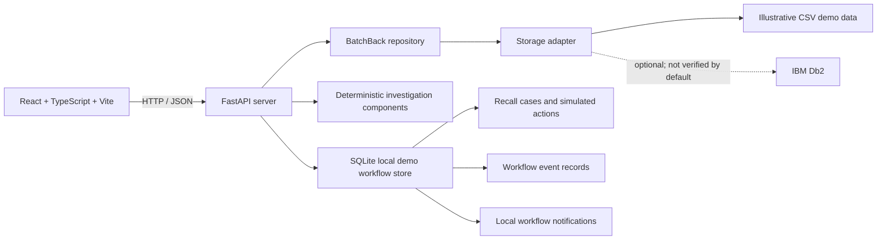
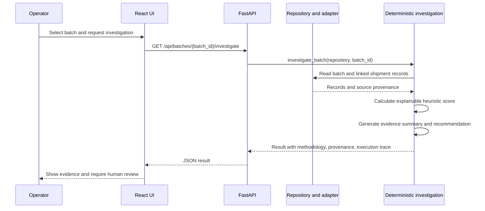

# BatchBack architecture and workflow

## Application architecture

Batch and shipment reads are routed through the repository. Demo mode is the default. The Db2 adapter validates both connectivity and the required table columns; unsuccessful reads use the CSV fallback and retain explicit source provenance. Recall workflow state remains local SQLite in this prototype, independent of the batch data adapter.

## Investigation sequence

The investigation stages are ordinary deterministic Python functions, not autonomous LLM agents. Scores and recommendations are not validated food-safety decisions.

## Recall lifecycle

1. A user creates a case from the current batch investigation. It is persisted as **Awaiting approval**.
2. A named reviewer records an approval or rejection with a reason. No external operation is triggered.
3. Only an **Approved** case can record destination actions. Each action requires an explicit operator simulation request and remains labeled simulated.
4. An approved case can be closed only after all of its destination steps have been simulated.
5. Each transition writes an event to the local audit table. These records are useful for demo traceability, but are not an immutable or production-grade audit system.
